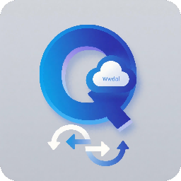

  

<h1 align="center">QMediaSync</h1>

连接网盘与 Emby，让媒体同步更简单。

  <a href="https://github.com/chen8945/QMediaSync/wiki">📖 使用手册</a> ·
  <a href="https://github.com/chen8945/QMediaSync/releases">📦 版本下载</a> ·
  <a href="https://github.com/chen8945/QMediaSync/issues">🐛 问题反馈</a>

---

QMediaSync 是一个开源的媒体同步工具，支持 115 网盘、百度网盘、OpenList 及本地挂载目录，提供文件同步和 STRM 生成，并支持与 Emby、飞牛影视联动。

## Docker 镜像

`ghcr.io/chen8945/qmediasync:latest`

从原项目迁移时，只需要将 Docker 镜像地址更换为以上地址。

## 致谢

本项目基于 qicfan 的开源项目开发，感谢原作者的贡献与分享。

- 后端：[qicfan/qmediasync](https://github.com/qicfan/qmediasync)
- 前端：[qicfan/q115-strm-frontend](https://github.com/qicfan/q115-strm-frontend)
- Wiki：[qicfan/qmediasync/wiki](https://github.com/qicfan/qmediasync/wiki)

## 精简美化

1. **移除初始化码机制**
   - 删除 `setup_token` 生成、验证、展示逻辑
   - 保留创建管理员功能（直接填写用户名+密码）
2. **移除公告功能**
   - 删除 `AnnouncementCard.vue`、`useAnnouncement.ts`
3. **移除刮削（Scrape）功能**
   - 删除 `scrape/` 目录全部文件（tmdb、fanart、rename、scan 等子模块）
   - 删除 `scrape.go`、`scrapemedia.go`、`scrapepath.go` 模型
   - 删除 `AppScrapePathes.vue`、`AppTmdbSettings.vue` 等前端组件
4. **移除网盘文件管理**
   - 删除 `net_file_batch.go`、`net_file_cache.go` 控制器
5. **移除版本更新功能**
   - 删除 `updater/` 模块（downloader、gitee\_updater）
   - 删除 `AppUpdate.vue`、`useUpdate.ts`
6. **UI/UX 优化**
   - 头像改用 favicon.ico（方形圆角）
